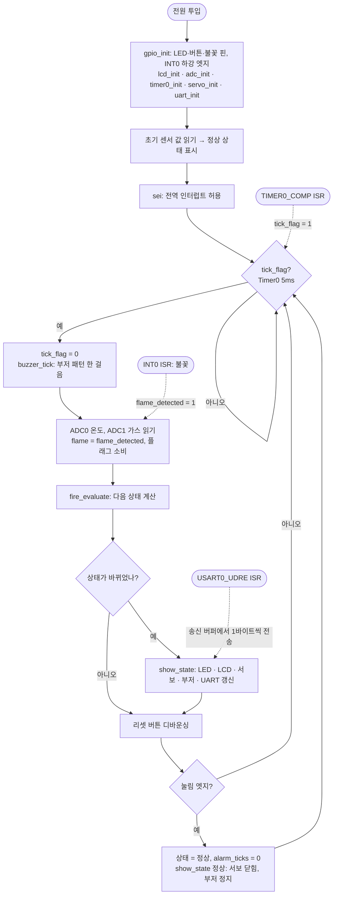
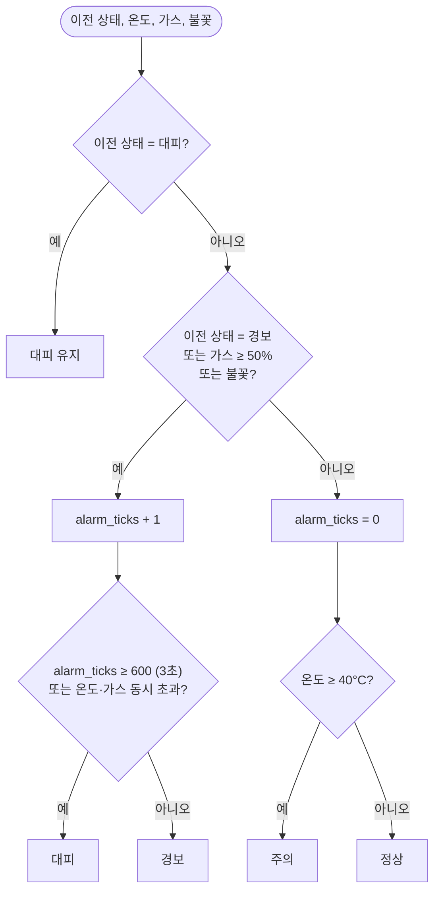
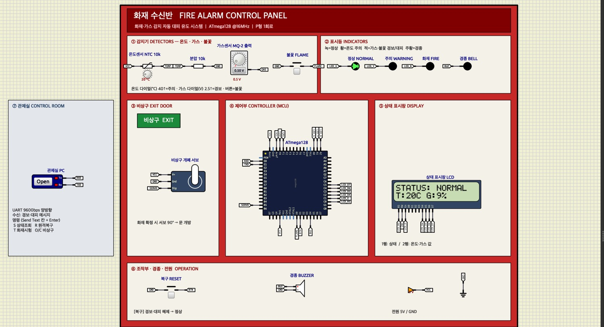
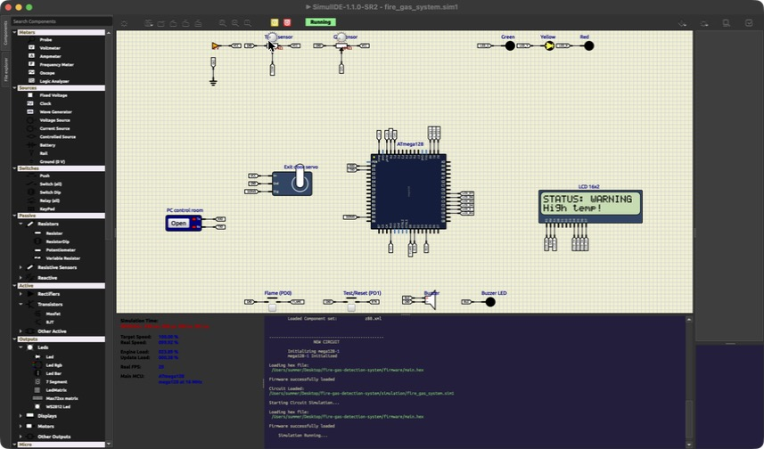
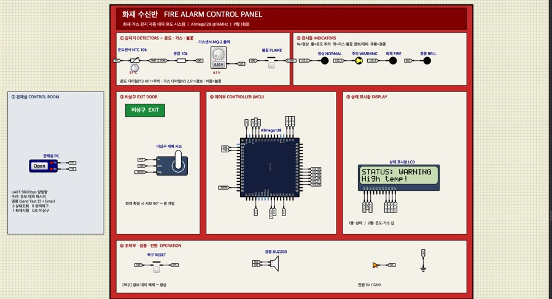
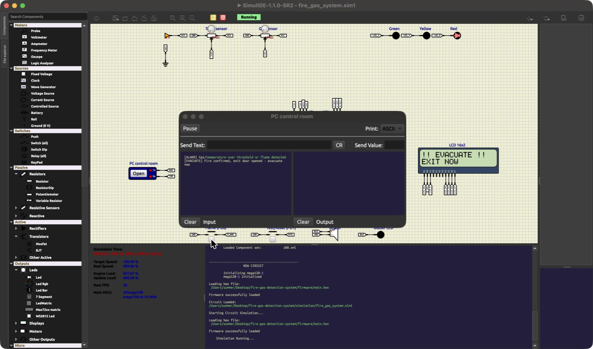
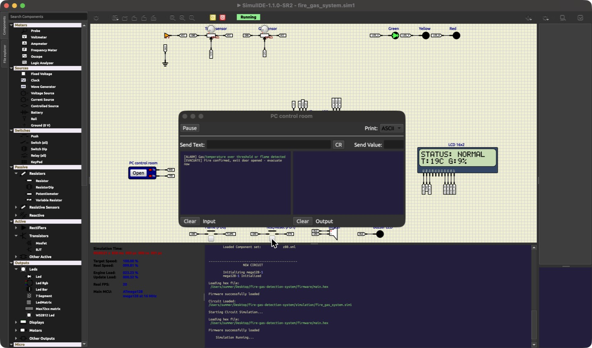

# 최종 보고서 — 화재·가스 감지 자동 대피 유도 시스템

- 과목: 마이크로프로세서 (2026-2학기) / 텀 프로젝트, 2인 1조
- 플랫폼: ATmega128 16MHz, avr-gcc 7.3 (`-Os`), 시뮬레이터 SimulIDE 1.1.0-SR2
- 저장소: https://github.com/hyeonggeun0721/fire-gas-detection-system

## 1. 프로젝트 개요

화재 초기 징후(온도 상승, 가스 누출, 불꽃)를 감지해 경보를 울리고, 비상구를 자동으로 열고,
LCD로 대피를 안내하고, UART로 PC 관제실에 신고하는 임베디드 시스템을 ATmega128로 구현했다.
관제실은 신고를 받기만 하는 것이 아니라 한 글자 명령(S·R·T·O·C)으로 수신반을 원격 조회·복구·시험할 수 있다(양방향 통신).
실제 하드웨어 대신 SimulIDE 가상 회로(`simulation/fire_gas_system.sim1`)에서 검증했다.

화재 대응은 반응 속도가 중요하므로 불꽃 감지는 외부 인터럽트로 즉시 받고, 센서 판단은 타이머
인터럽트로 5ms마다 일정하게 수행하며, 부저와 UART 송신은 메인 루프를 막지 않는 방식으로 만들었다.

관련 문서: 요구사항 `docs/requirements.md`, 회로·핀맵 `docs/architecture.md`,
시나리오와 결과 `docs/test-scenarios.md`, 시뮬레이션 트러블슈팅 `docs/troubleshooting-simulide.md`.

## 2. 요구사항 정의 및 기능 명세

### 2.1 입출력 정의

| 구분 | 장치 | 신호 | 동작 조건 |
|---|---|---|---|
| 입력 | 온도 센서 (NTC 서미스터 10kΩ, B=3950 + 10kΩ 분압) | 아날로그 → ADC0, 변환표 보간 | 40°C 이상이면 주의 |
| 입력 | 가스 센서 (MQ-2 아날로그 출력을 전압원 0~5V로 모사) | 아날로그 → ADC1 | 50%(2.5V) 이상이면 경보 |
| 입력 | 불꽃 센서 (푸시버튼 모사, 활성 LOW) | 디지털 → INT0 | 하강 엣지에서 즉시 경보 |
| 입력 | 테스트/리셋 버튼 (활성 LOW) | 디지털, 20ms 디바운싱 | 어느 상태에서든 정상으로 복귀 |
| 출력 | LED 3개 | GPIO | 녹색(정상) / 노랑(주의) / 빨강(경보·대피) |
| 출력 | LCD 16x2 | GPIO 4비트 | 상태와 온도·가스 값, 대피 문구 |
| 출력 | 서보모터 (비상구) | PWM 50Hz | 대피 시 90° 개방, 그 외 닫힘 |
| 출력 | 부저 | GPIO | 주의·경보 1회, 대피 3회 (100ms 간격) |
| 출력 | PC 관제실 | UART TXD0 9600bps 8N1 | 경보·대피 진입 시 메시지 1회, 명령 회신 |
| 입력 | PC 관제실 명령 | UART RXD0, 수신 인터럽트 | `S` 상태 조회 · `R` 원격 복구 · `T` 화재 시험 · `O`/`C` 비상구 열기/닫기 |

### 2.2 상태와 전이 규칙

| 상태 | 진입 조건 | 동작 | 해제 |
|---|---|---|---|
| 정상 | 모든 센서 정상 | 녹색 LED, `STATUS: NORMAL` / `T:xxC G:xx%`, 서보 닫힘 | — |
| 주의 | 온도 ≥ 40°C | 노랑 LED, `High temp!`, 부저 1회 | 온도가 내려가면 자동 해제 |
| 경보 | 가스 ≥ 50%, 불꽃 감지, 또는 관제실 `T` | 빨강 LED, `!! ALARM !!`, 부저 1회, UART `[ALARM]` | 리셋 버튼 또는 관제실 `R` (래치) |
| 대피 | 경보 3초 지속, 또는 온도·가스 동시 초과 | `!! EVACUATE !!` / `EXIT NOW`, 서보 개방, 부저 3회, UART `[EVACUATE]` | 리셋 버튼 또는 관제실 `R` (래치) |

경보와 대피는 센서 값이 내려가도 유지(래치)된다. 실제 화재경보 수신반처럼 사람이 확인하고 리셋해야
풀리게 한 것이다. 이 규칙은 시뮬레이션 검증에서 래치가 빠져 있던 버그를 찾아 고치면서 확정했다(7.4절).

### 2.3 시스템 흐름도



(hwp·pdf로 옮길 때는 같은 그림의 PNG `docs/images/flowchart_main.png`, `docs/images/flowchart_fire_logic.png`를 쓰면 된다.)

`fire_evaluate()`의 판단 순서:



## 3. 회로 설계 및 ATmega128 리소스 할당

### 3.1 핀 할당과 근거

| 장치 | 핀 | 주변장치 | 이 핀을 고른 이유 |
|---|---|---|---|
| 온도 센서 | PF0 | ADC0 | ATmega128의 ADC 입력은 PORTF에만 있다 |
| 가스 센서 | PF1 | ADC1 | 같은 ADC를 채널 전환(ADMUX)으로 공유 |
| 불꽃 센서 | PD0 | INT0 | 폴링 없이 하드웨어 인터럽트로 즉시 반응 |
| 테스트/리셋 버튼 | PD1 | GPIO 입력, 내부 풀업 | 5ms 틱마다 읽고 소프트웨어 디바운싱 |
| 서보모터 | PB5 | Timer1 OC1A | 16비트 타이머라 펄스폭 분해능이 0.5µs로 높아 떨림이 적다 |
| 상태 LED | PA0~PA2 | GPIO 출력 | 특별한 제약이 없는 범용 포트에 모음 |
| LCD | PC0~PC5 | GPIO 출력 (RS, E, D4~D7) | 4비트 모드로 핀 6개만 사용, 한 포트에 모아 배선 정리 |
| 부저 | PD4 | GPIO 출력 | 범용 핀, 논블로킹 시퀀서로 토글 |
| PC 관제실 | PE1 / PE0 | USART0 TXD0 / RXD0 | USART0 송수신 핀은 하드웨어로 고정 |
| 전원 | RST, AVCC, AREF | 5V | 리셋 해제, ADC 기준전압 (7.2절) |

### 3.2 주변 회로

- **풀업 저항:** 불꽃·리셋 버튼은 외부 저항 없이 내부 풀업(`PORTD |= 1<<PD0|1<<PD1`, `DDRD` 해당 비트 0)을
  사용한다. 버튼을 누르면 GND로 당겨져 LOW가 된다.
- **전류 제한:** SimulIDE의 LED 모델은 직렬 저항(50Ω)과 최대 전류(30mA)를 내장하고 있다. 실제 보드라면
  5V에서 LED 전류를 10mA 정도로 맞추기 위해 330Ω 직렬 저항이 필요하다
  ((5V − 2V) / 330Ω ≈ 9mA, ATmega128 핀당 정격 40mA 이내).
- **온도 센서 분압 회로:** 5V ─ NTC ─┬─ ADC0 ─ 10kΩ ─ GND. 온도가 오르면 NTC 저항이 줄어 ADC0 전압이 오른다.
  25°C에서 NTC = 10kΩ이라 2.5V(ADC 512)로 측정 범위 한가운데에 오고, 주의 임계값 40°C 부근 기울기가
  약 8카운트/°C라 분해능이 충분하다. NTC 저항은 온도에 대해 지수 함수 R(T) = R25·exp(B·(1/T − 1/298.15))라
  AVR에서 직접 풀지 않고, −20~120°C를 5°C 간격으로 미리 계산한 표(`firmware/tools/gen_ntc_table.py`)를
  상수 배열(29개, 58바이트)로 두고 직선 보간한다(`temp.c`). 호스트 테스트에서 0~100°C 전 구간 오차가 1°C 이내임을 확인했다.
- **가스 센서:** SimulIDE에는 가스 센서 부품이 없어, MQ-2 모듈의 아날로그 출력(AO, 0~5V)을 가변 전압원으로
  흉내 냈다. 0~5V를 0~100%로 선형 변환한다(`gas.c`).
- **ADC 기준전압:** AVCC를 기준으로 쓰고 AREF도 5V에 연결했다. 실제 보드에서는 AREF와 GND 사이에
  0.1µF 커패시터를 다는 것이 데이터시트 권장이다.
- **서보 전원:** 서보 V+는 5V, GND는 공통 접지. 실제 서보는 순간 전류가 커서 MCU와 전원을 분리하는 것이 좋다.

### 3.3 시뮬레이터 회로



빨간 캐비닛과 구역 패널(①~⑦)은 그래픽 부품이라 전기적 영향이 없다. 처음 회로는 아래와 같았다.


전선 대신 같은 이름의 터널(Tunnel)끼리 연결된다. 예: MCU의 PC0 옆 `LCD_RS`와 LCD RS 핀 옆 `LCD_RS`.
연결 목록은 `simulation/README.md`에 있다.

## 4. 레지스터 설정과 펌웨어 구조

### 4.1 핵심 레지스터 설정 근거

| 기능 | 레지스터 = 값 | 비트 설정 이유 |
|---|---|---|
| LED 출력 | `DDRA \|= 0x07` | PA0~PA2를 출력으로 |
| 버튼 입력 | `DDRD &= ~(1<<PD0\|1<<PD1)`, `PORTD \|= 같은 비트` | 입력 + 내부 풀업 |
| 부저 출력 | `DDRD \|= 1<<PD4` | PD4 출력 |
| LCD | `DDRC \|= 0x3F` | PC0~PC5 출력 (RS, E, D4~D7) |
| 외부 인터럽트 | `EICRA: ISC01=1, ISC00=0` / `EIMSK: INT0=1` | INT0 하강 엣지 (불꽃 센서가 LOW로 떨어지는 순간) |
| 5ms 틱 | `TCCR0 = WGM01 \| CS02 \| CS01 \| CS00` | CTC 모드, 분주비 1024 |
| | `OCR0 = 77` | 16MHz / 1024 / 200Hz − 1 = 77 → 78 × 64µs = 4.992ms |
| | `TIMSK \|= 1<<OCIE0` | 비교 일치 인터럽트 허용 |
| ADC | `ADMUX = 1<<REFS0` | 기준전압 AVCC(5V), 우측 정렬, 채널은 읽을 때 MUX 비트로 지정 |
| | `ADCSRA = ADEN \| ADPS2 \| ADPS1 \| ADPS0` | ADC 켬, 분주비 128 → 125kHz (권장 50~200kHz) |
| 서보 PWM | `TCCR1A = COM1A1 \| WGM11`, `TCCR1B = WGM13 \| WGM12 \| CS11` | Fast PWM(모드 14), TOP=ICR1, 비반전 출력, 분주비 8 |
| | `ICR1 = 39999` | 16MHz / 8 / 50Hz − 1 → 20ms 주기 |
| | `OCR1A = 2000 / 3000` | 1ms(닫힘) / 1.5ms(90° 개방). 1틱 = 0.5µs |
| UART | `UBRR0 = 103` | 16MHz / (16 × 9600) − 1 = 103.2 → 오차 0.2% |
| | `UCSR0B = RXEN0 \| TXEN0 \| RXCIE0`, 보낼 데이터가 있을 때만 `UDRIE0` | 송수신 활성, 수신 완료 인터럽트로 명령 수신, UDRE 인터럽트로 한 바이트씩 전송 |
| | `UCSR0C = UCSZ01 \| UCSZ00` | 8비트, 패리티 없음, 정지 비트 1 |

### 4.2 ISR과 메인 루프 분리

ISR은 플래그만 세우거나 한 바이트만 처리하고, 무거운 작업(ADC 변환, 상태 판단, LCD 쓰기)은 모두
메인 루프에서 한다.

| ISR | 하는 일 | 메인 루프에서 하는 일 |
|---|---|---|
| `INT0_vect` | `flame_detected = 1` | 다음 틱에서 플래그를 읽고 0으로 소비 → 상태 판단 |
| `TIMER0_COMP_vect` | `tick_flag = 1` | 플래그를 기다렸다가 5ms마다 한 번 센서 읽기·판단·버튼 처리 |
| `USART0_UDRE_vect` | 송신 버퍼에서 1바이트를 `UDR0`에 씀, 비면 `UDRIE0` 끔 | `uart_puts()`로 버퍼에 넣고 바로 다음 일 |
| `USART0_RX_vect` | `UDR0`에서 받은 글자를 수신 버퍼(16바이트)에 넣음 | 틱마다 `uart_getc_nb()`로 꺼내 `handle_command()`에서 해석·실행·회신 |

ISR과 공유하는 변수(`flame_detected`, `tick_flag`, 송수신 버퍼 인덱스)는 `volatile`로 선언했다.
부저도 `_delay_ms()` 대신 틱마다 한 걸음씩 진행하는 시퀀서라 메인 루프를 막지 않는다.
남은 블로킹은 LCD 쓰기(상태가 바뀔 때만 약 5~8ms)뿐이다.

### 4.3 코드 구조

```
firmware/
  main.c           메인 루프, ISR, 상태 표시(show_state), 관제실 명령 처리(handle_command)
  fire_logic.c/h   화재 판단 상태 기계 (순수 로직, 래치 포함)
  debounce.c/h     버튼 디바운싱 (순수 로직)
  temp.c/h, gas.c/h  ADC 값 → 섭씨(NTC 변환표 보간) / 백분율 (순수 로직)
  tools/           NTC 변환표 생성 스크립트 (gen_ntc_table.py)
  buzzer_seq.c     부저 논블로킹 시퀀서 (순수 로직)
  adc.c/h          ADC 드라이버 (채널 전환·초기 변환 안정화)
  lcd.c/h          HD44780 4비트 드라이버
  servo.c/h        Timer1 PWM 서보
  uart.c/h         USART0 인터럽트 송수신 드라이버 (링버퍼)
  buzzer.c/h       부저 하드웨어 래퍼
  tests/           호스트 단위 테스트 8종
```

하드웨어 레지스터에 의존하지 않는 순수 로직을 분리해, 시뮬레이터 없이도 `make test`로 검증할 수 있게 했다.

## 5. 시뮬레이션 검증

### 5.1 검증 방법

- **SimulIDE 1.1.0-SR2:** 회로 파일에 최종 `main.hex`를 올려 시나리오를 직접 조작하고 화면으로 확인
- **simavr:** 같은 펌웨어를 1ms 단위로 실행해 타이밍(버튼 반응, 부저, UART)을 측정.
  SimulIDE의 3바이트 복귀 주소 조건(7.1절)도 재현해서 실행
- **호스트 단위 테스트:** `make test`, 8종 모두 통과

### 5.2 시나리오 결과

| 시나리오 | 결과 | 관찰 |
|---|---|---|
| A 기본 부팅 | 통과 | 녹색 LED, `STATUS: NORMAL` / `T:19C G:9%` |
| B 온도만 상승 | 통과 | 노랑 LED, `STATUS: WARNING` / `High temp!` |
| C 가스만 상승 | 통과 | 빨강 LED, `!! ALARM !!`, 터미널 `[ALARM] ...` |
| D 불꽃 감지 | 통과 | 버튼을 뗀 뒤에도 경보 유지, 3초 뒤 대피 |
| E 대피 자동 격상 | 통과 | 3초 뒤 `EXIT NOW`, 서보 90° 개방, 터미널 `[EVACUATE] ...` |
| F 온도+가스 동시 | 통과 | 경보를 거치지 않고 즉시 대피 (simavr) |
| G 리셋 버튼 | 통과 | 정상 복귀, 서보 닫힘, 부저 즉시 정지 |
| H 대피 직후 반응성 | 통과 | 대피 80ms 뒤 누른 버튼이 20ms(디바운싱) 뒤 인식 (simavr) |
| I 관제실 원격 명령 | 통과 | `S` 회신, `T`→경보→3초 뒤 대피, 대피 중 `C` 거부, `R` 복구, `O`/`C` 서보, 잘못된 글자 `ERR` (simavr) |










## 6. 개발 과정 (주차별 요약)

| 주차 | 내용 | 겪은 오류 | 검증 방법 |
|---|---|---|---|
| 1 | 요구사항 정의 | - | - |
| 2 | 아키텍처/핀맵 설계 | - | - |
| 3 | 개발 환경 구축 | Makefile MCU 오타(atmega18) | avr-gcc 빌드 오류 재현 |
| 4 | GPIO LED/부저 | DDRA 설정 누락 | avr-objdump |
| 5 | 버튼 입력/디바운싱 | 디바운싱 미적용 | 호스트 테스트(바운스 파형 모사) |
| 6 | LCD 연동 | 4비트 웨이크업 시퀀스 누락 | avr-objdump |
| 7 | ADC 온도 | 기준전압 오설정(2.56V vs 5V) | 호스트 테스트(25°C → 48°C 오독) |
| 8 | ADC 가스/채널 전환 | 채널 전환 안정화 누락 | 데이터시트 근거 + objdump |
| 9 | 불꽃/외부 인터럽트 | 플래그 리셋 누락 | 호스트 테스트(1회 → 150회 반복) |
| 10 | 타이머 스케줄링 | 프리스케일러 오선택(OCR0 절삭) | 컴파일 경고 + 호스트 테스트 |
| 11 | 서보 PWM | 각도-듀티 매핑 오류 | 호스트 테스트(유효 펄스폭) |
| 12 | 화재 판단 상태 기계 | 경보 조건에 불꽃 누락(회귀) | unused-parameter 경고 + 호스트 테스트 |
| 13 | UART 관제실 통신 | 보드레이트 불일치 | 호스트 테스트(오차 계산) |
| 14 | 통합 테스트 | 부저 블로킹(최대 600ms) | 논블로킹 시퀀서 + 호스트 테스트 |
| 15 | 최종 통합 | - | 전체 재빌드, 전체 테스트 |
| 시뮬레이션 | SimulIDE 실행·시나리오 검증 | 7장의 문제 6가지 | SimulIDE, simavr, objdump |

주차별 상세는 `reports/week01.md` ~ `week15.md`에 있다.

## 7. 시뮬레이션 트러블슈팅

상세 기록과 캡처는 `docs/troubleshooting-simulide.md`에 있다. 요약:

### 7.1 Running인데 아무 반응 없음 → 리셋 반복

MCU 모니터로 PC를 여러 번 찍으니 항상 `lcd_init()` 안이었지만, UART·타이머·서보 레지스터는 이미
설정돼 있었다. 초기화 뒤 0번지로 튕겨 다시 시작하는 것을 반복하고 있었다. 같은 펌웨어가 simavr에서는
정상이라 도구 차이를 의심했고, SimulIDE 소스에서 ATmega128의 복귀 주소를 **3바이트**로 처리하는 것을
찾았다(실제 칩은 2바이트). avr-gcc `-Os`가 작은 지역 변수 공간을 `rcall .+0`으로 잡는 함수에서
스택이 어긋났다. 처음엔 `snprintf`만 없앴다가 증상이 바뀌는 것(LCD 첫 줄만 표시)을 보고 디스어셈블로
진짜 원인을 확인했다. 지역 배열과 주소를 넘기는 지역 변수를 없애 `rcall .+0`을 0개로 만들었다.

### 7.2 온도·가스 값이 0

ADC 기준전압을 AVCC로 고르면 SimulIDE는 AREF 핀 전압을 읽는데, 회로에서 AREF가 떠 있었다.
AREF를 5V에 연결했다. 부팅 직후 첫 판독만 0으로 나오는 현상은 `adc_init()`에서 첫 변환을 버려 해결했다.

### 7.3 시리얼 터미널 한글 깨짐 (예방)

터미널이 ASCII로 표시하므로 UART 메시지를 영문으로 바꿨다.

### 7.4 경보가 유지되지 않음 (시나리오 D)

불꽃 버튼 경보가 5ms 만에 풀렸다. 상태 판단이 매 틱 현재 센서 값만 봤기 때문이다.
경보·대피를 리셋 전까지 유지하도록 바꾸고 단위 테스트 4개를 추가했다.

### 7.5 대피 직후 버튼 반응 지연 (시나리오 H)

UART 송신이 블로킹이라 메시지 하나에 약 60ms 동안 메인 루프가 멈춰, 버튼 반응이 약 70ms 늦었다.
송신 버퍼와 UDRE 인터럽트로 바꿔 20ms(디바운싱 시간)로 줄였다.

### 7.6 리셋 후 부저가 잠깐 더 울림

정상 복귀 시 `buzzer_stop()`을 호출하도록 했다.

## 8. 버전 관리

`main` 단일 브랜치로 진행했다. 커밋 메시지는 `[WeekNN] 기능/버그/수정/문서: 내용` 형식이고,
시뮬레이션 단계는 `[Sim]` 접두어를 썼다. 의도적 오류는 "버그 재현" 커밋과 "수정" 커밋을 분리해
이력에서 원인과 해결을 따라갈 수 있게 했다.

<!-- 제출 전: GitHub 커밋 목록 또는 `git log --oneline` 화면 캡처를 여기에 넣는다 -->

## 9. 빌드·실행 방법

```bash
cd firmware
make          # main.hex 생성 (avr-gcc 필요)
make test     # 호스트 단위 테스트 8종 (일반 gcc)
```

SimulIDE에서 `simulation/fire_gas_system.sim1`을 열고 전원 버튼을 누르면 `firmware/main.hex`가 자동으로 올라간다.

리소스 사용량 (`avr-size`): 플래시 3,182바이트(128KB의 2.4%), SRAM 634바이트(4KB의 15.5%).
`avr-gcc -Wall -Wextra`로 경고 없음.

## 10. 한계 및 향후 개선

- LCD 쓰기는 아직 블로킹(상태가 바뀔 때만 약 5~8ms)이다. 버퍼에 써 두고 틱마다 한 글자씩 내보내면 없앨 수 있다.
- 경보와 대피가 빨강 LED 하나를 공유한다. 대피는 LED를 깜빡이게 하면 구분이 더 쉬워진다.
- 임계값(40°C, 50%)과 대피 격상 시간(3초)은 시뮬레이션용 예시 값이다.
- 가스 센서는 전압원으로 대체했다. 실제 MQ-2는 농도(ppm)에 대해 비선형이고 예열 시간(수십 초~수 분)이 필요하므로, 실제 적용 시에는 데이터시트 곡선으로 보정하고 부팅 직후 예열 동안 판정을 미뤄야 한다.
- NTC 변환표는 B값 근사식 기준이다. 실제 부품은 허용오차(±1~5%)가 있어 한두 점 실측 보정이 필요하다.
- 관제실 명령에 인증이 없다. 시리얼 선에 연결된 누구나 `R`로 경보를 끌 수 있으므로, 실제 적용 시에는 명령 인증(비밀번호·MAC)과 조작 기록(로그)이 필요하다.
- 관제실 명령은 한 글자 형식이라 잘못 입력할 위험이 있다. 실제 시스템이라면 `R` 같은 위험 명령에 확인 절차를 두는 것이 좋다.
- 시나리오 F·H는 simavr로 타이밍을 측정했고, SimulIDE 화면으로는 A~E·G를 확인했다.

## 11. 느낀 점

<!-- 팀원 각자 본인의 말로 작성: 무엇이 어려웠고, 무엇을 새로 알게 됐는지.
     예) 시뮬레이터가 실제 칩과 다르게 동작할 수 있다는 점, 시나리오를 끝까지 돌려야 보이는 버그 등 -->
