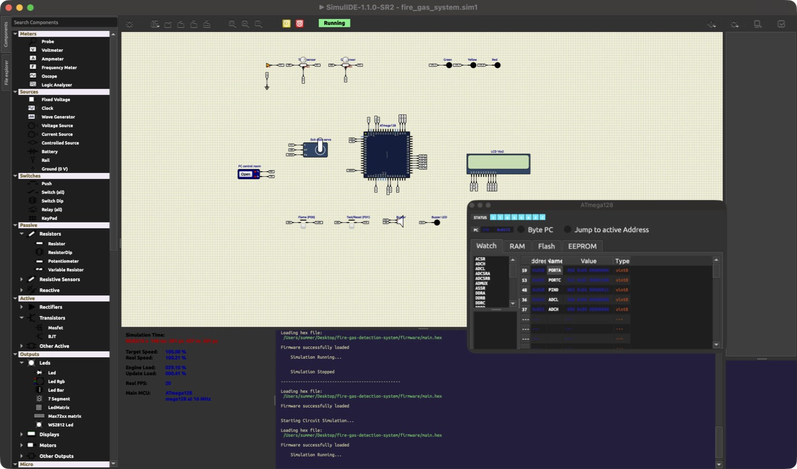
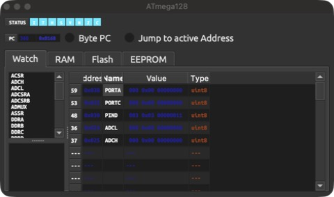
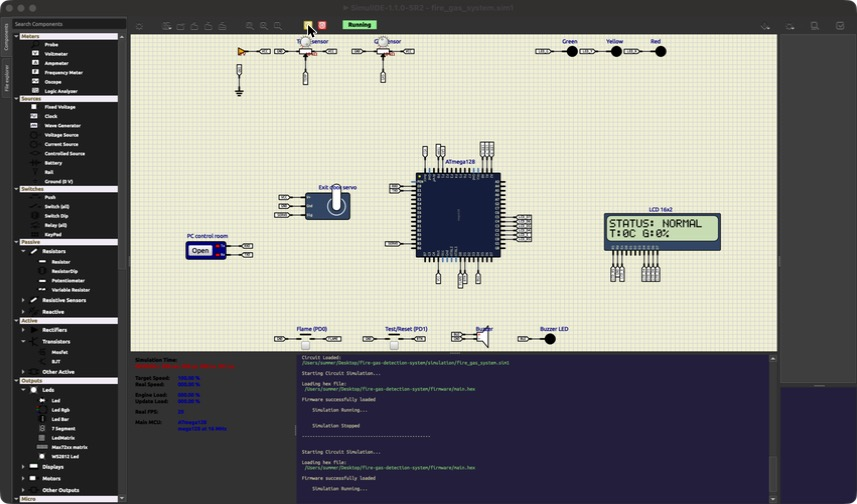
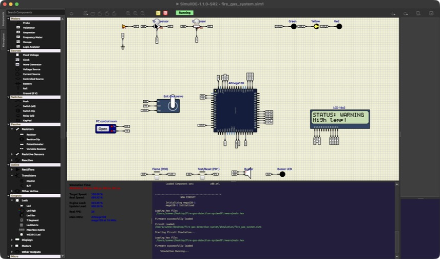

# SimulIDE 시뮬레이션 트러블슈팅 기록

- 날짜: 2026-11-18
- 환경: SimulIDE 1.1.0-SR2 (macOS), ATmega128 16MHz, avr-gcc 7.3 (`-Os`)
- 회로: `simulation/fire_gas_system.sim1` / 펌웨어: `firmware/main.hex`

시뮬레이터에서 처음 실행했을 때 두 가지 문제가 나왔다. 하나는 SimulIDE의 ATmega128 모델과
컴파일러 최적화가 맞물려 생긴 리셋 반복이고, 다른 하나는 ADC 기준전압 핀 배선 누락이다.

| # | 증상 | 원인 | 해결 |
|---|---|---|---|
| 1 | Running인데 LED·LCD·UART 모두 반응 없음 | SimulIDE ATmega128 모델이 복귀 주소를 3바이트로 처리 → `rcall .+0` 프레임에서 스택 불일치 → 리셋 반복 | `snprintf` 제거, 지역 배열·주소를 넘기는 지역 변수 제거 (`rcall .+0` 0개) |
| 2 | LCD에 `T:0C G:0%`, 가변저항을 돌려도 0 | ADC 기준전압을 AVCC로 골랐지만 회로에서 AREF 핀이 떠 있음 | AREF(PV1)도 5V에 연결 |
| 3 | (예방) UART 신고 메시지가 한글 | SimulIDE 시리얼 터미널은 ASCII로 표시 | 메시지를 영문으로 변경 |

---

## 문제 1. 시뮬레이션은 도는데 아무 반응이 없음

### 증상

- 상태 표시는 `Running`, 시뮬레이션 시간도 계속 증가
- 로그에 `Firmware successfully loaded` → 펌웨어는 정상 로드
- 녹색 LED 꺼짐, LCD 공백, 시리얼 터미널 출력 없음

### 관찰 (MCU 모니터)





| 항목 | 값 | 의미 |
|---|---|---|
| PC (여러 번 확인) | 0x167, 0x168, 0x173 (워드 주소) | 바이트 주소 0x2CE~0x2E6 = `lcd_init()`의 지연 루프 |
| UBRR0L / UCSR0B | 0x67 / 0x08 | `uart_init()`까지 실행됨 (9600bps, TX 활성) |
| TCCR0 / TIMSK | 0x0F / 0x02 | `timer0_init()` 실행됨 |
| OCR1A | 2000 | `servo_init()` 실행됨 |
| PORTA | 0x00 | `show_state()`가 켠 녹색 LED가 다시 꺼짐 |
| SREG | I = 0 | `sei()` 이전 상태 |

초기화 함수가 끝까지 실행된 흔적이 있는데 PC는 항상 맨 앞 `lcd_init()`에 있다.
→ **초기화 뒤 화면 표시 중에 0번지로 튕겨 처음부터 다시 시작하는 것을 반복**한다고 판단했다.
(SimulIDE의 리셋은 하드 리셋이 아니라 0번지 점프라 I/O 레지스터 값이 그대로 남아 있었다.)

### 교차 검증

같은 `main.elf`를 다른 AVR 시뮬레이터(simavr, ATmega128 16MHz)로 실행하면 정상 동작했다.
녹색 LED → 가스 상승 시 경보 메시지 → 3초 뒤 대피 메시지·서보 개방까지 확인.
→ 펌웨어 로직이 아니라 **SimulIDE 쪽 차이**가 원인.

### 원인

SimulIDE 소스(`src/microsim/cores/mcucpu.cpp`)는 플래시 크기로 복귀 주소 크기를 정한다.

```
if     ( m_progSize <= 0xFF )     m_progAddrSize = 1;
else if( m_progSize <= 0xFFFF )   m_progAddrSize = 2;
else if( m_progSize <= 0xFFFFFF ) m_progAddrSize = 3;
```

ATmega128 정의 파일의 플래시 크기는 131072라 **3바이트**가 된다.
하지만 실제 ATmega128의 PC는 16비트라 CALL/RCALL은 복귀 주소를 **2바이트**만 스택에 넣는다.
avr-gcc도 2바이트를 가정하고 코드를 만든다.

평범한 CALL/RET은 넣고 빼는 크기가 같아서 문제가 없다. 문제는 `-Os` 최적화가 작은 지역 변수 공간을
확보하는 방식이다.

```
append_uint:
    ...
    rcall .+0      ; 바로 다음 명령을 "호출" → 복귀 주소(2바이트)만큼 스택 공간 확보
    rcall .+0      ; 2바이트 더
    push  r1       ; 1바이트 더  → 총 5바이트 지역 변수 공간
    ...
    pop r0 ×5      ; 5바이트 해제
    ret
```

SimulIDE에서는 `rcall .+0`이 3바이트씩 넣어서 7바이트가 쌓이는데 5바이트만 빠진다.
그래서 `ret`이 엉뚱한 값을 복귀 주소로 꺼내 0번지 근처로 점프하고, 프로그램이 처음부터 다시 돈다.

### 1차 수정과 재발

처음에는 인자를 스택으로 받는 가변 인자 함수 `snprintf()`만 원인이라고 보고,
숫자를 문자열로 바꾸는 `append_uint()` / `append_int()`로 바꿨다.

결과: LCD에 `STATUS: NORMAL` 첫 줄까지는 나오지만 둘째 줄이 안 나오고 화면이 계속 다시 그려졌다.
`avr-objdump`로 확인하니 새로 만든 `append_uint()`의 지역 배열 `tmp[5]`가 다시 `rcall .+0`으로
잡혀 있었다. 원인은 `snprintf` 자체가 아니라 **`rcall .+0` 프레임 확보 방식**이었다.

### 최종 수정 (`firmware/main.c`)

1. `snprintf()` 제거 → `append_uint()` / `append_int()`로 LCD 문자열 생성
2. `append_uint()`를 지역 배열 없이 10000, 1000, … 자리부터 나눠 쓰는 방식으로 변경
3. `main()`의 `button_db`, `alarm_ticks`를 `static`으로 변경 (주소를 넘기는 지역 변수라 스택 프레임이 생김)

검증 방법:

```
avr-objdump -d firmware/main.elf | grep -c "rcall\s*\.+0"     # 결과 0
```

simavr에서 복귀 주소를 3바이트로 강제(SimulIDE 조건 재현)했을 때 수정 전 펌웨어는 crash,
수정 후 펌웨어는 정상 → 원인과 해결 모두 재현으로 확인했다.
실제 ATmega128 칩에서는 원래 코드도 문제가 없다. 이번 수정은 시뮬레이터 호환을 위한 것이다.

---

## 문제 2. 온도·가스 값이 항상 0

### 증상

문제 1을 고친 뒤 LCD에 `STATUS: NORMAL` / `T:0C G:0%`가 표시됐다.
가변저항 위치와 상관없이 항상 0이었다.



### 원인

펌웨어는 ADC 기준전압으로 AVCC를 고른다 (`ADMUX = 1<<REFS0`).
SimulIDE의 AVR ADC 모델(`avradc.cpp`)은 이때 AVCC 전압을 **AREF 핀에 걸고, AREF 핀 전압을 다시 읽어**
기준전압으로 쓴다. 회로에서 AREF 핀이 아무 데도 연결되지 않아 기준전압이 0V로 읽혔다.
SimulIDE 예제 회로(`m32_adc.sim1`)도 AVCC와 AREF를 둘 다 5V에 연결해 두고 있었다.

### 해결

회로에서 AREF(PV1) 핀을 5V(VCC)에 연결했다.
실제 보드에서는 AVCC 기준을 쓸 때 AREF와 GND 사이에 0.1µF 커패시터를 다는 것이 데이터시트 권장 사항이다.

### 결과




정상 상태에서 녹색 LED와 `STATUS: NORMAL`, 가스 9%가 표시되고, Temp 다이얼을 올리면 노랑 LED와
`STATUS: WARNING` / `High temp!`로 바뀌는 것까지 확인했다.

남은 현상: 부팅 직후 첫 화면의 온도가 `T:0C`로 나온다. 전원 투입 후 첫 ADC 변환(채널 0)이 SimulIDE에서
0으로 읽히는 것으로 보이며, 두 번째 변환(가스)부터는 정상이다. 상태 판정에는 영향이 없다
(다이얼을 올리면 주의 상태로 정상 전환). `adc_init()`에서 버리는 변환을 한 번 해 두면 해결될 것으로 예상한다.

---

## 문제 3. (예방) 시리얼 터미널 한글 깨짐

SimulIDE의 시리얼 터미널은 수신 바이트를 ASCII로 보여준다. 한글 UTF-8 메시지는 깨져 보이므로
UART 메시지를 영문으로 바꿨다.

| 상태 | 이전 | 변경 |
|---|---|---|
| 경보 | `[경보] 가스 또는 온도 임계값 초과, 혹은 불꽃 감지` | `[ALARM] Gas/temperature over threshold or flame detected` |
| 대피 | `[대피] 화재 확정, 비상구 개방 - 즉시 대피 바랍니다` | `[EVACUATE] Fire confirmed, exit door opened - evacuate now` |

---

## 배운 점

- "Running인데 반응 없음"은 펌웨어 로드 실패만이 아니라 **리셋 반복**일 수 있다. PC를 여러 번 찍어보고
  레지스터에 초기화 흔적이 남아 있는지 보면 구분할 수 있다.
- 다른 시뮬레이터로 같은 바이너리를 돌려보는 교차 검증이 "내 코드 문제인가, 도구 문제인가"를 빨리 가른다.
- 1차 수정 뒤 증상이 바뀐 것(첫 줄만 표시)이 진짜 원인(`rcall .+0`)을 찾는 단서가 됐다.
  디스어셈블(`avr-objdump -d`)로 컴파일러가 실제로 만든 명령을 보는 것이 결정적이었다.
- 시뮬레이터 부품 모델은 실제 칩과 세부 동작이 다를 수 있다. AREF처럼 실제 회로에서도 신경 써야 하는 핀은
  시뮬레이션 회로에도 빠짐없이 연결하는 게 안전하다.
