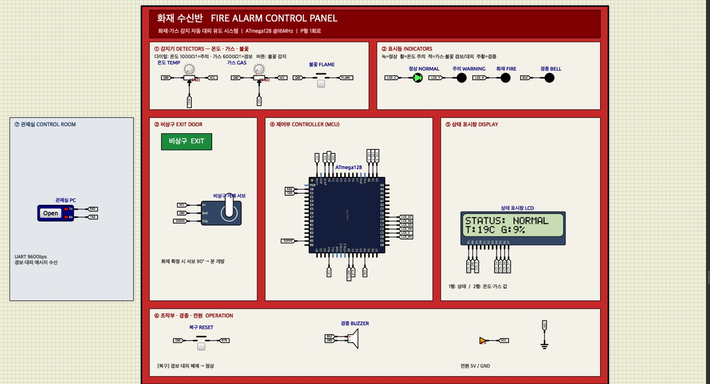

# SimulIDE 회로 파일 — 화재·가스 감지 자동 대피 유도 시스템

`fire_gas_system.sim1`은 SimulIDE 1.1.0용 회로 파일입니다. `docs/architecture.md`의 핀맵대로 부품을 모두 배치해 두었고,
MCU에는 `../firmware/main.hex`가 자동으로 로드되도록 설정했습니다.

## 여는 방법

1. SimulIDE 실행 → File → Open → 이 폴더의 `fire_gas_system.sim1`
2. 왼쪽 위 전원 버튼을 누르면 시뮬레이션이 시작됩니다.
3. 펌웨어를 고쳐서 다시 빌드했다면, MCU 우클릭 → Reload firmware (또는 전원을 껐다 켜기)

`simulation` 폴더를 옮기면 hex 경로가 깨집니다. 저장소 안에서 `firmware` 폴더와 나란히 두세요.

## 외형 (화재 수신반 패널)

실제 화재 수신반처럼 보이도록 빨간 캐비닛과 구역 패널을 씌웠습니다. 패널·글자는 SimulIDE의
Rectangle·TextComponent(그래픽 부품)라 **전기적으로는 아무 영향이 없습니다.**

| 구역 | 들어 있는 부품 |
|---|---|
| ① 감지기 DETECTORS | 온도·가스 가변저항, 불꽃 버튼(PD0) |
| ② 표시등 INDICATORS | 정상(녹)·주의(황)·화재(적) LED, 경종 LED(주황) |
| ③ 비상구 EXIT DOOR | 비상구 표지, 개폐 서보 |
| ④ 제어부 CONTROLLER | ATmega128 |
| ⑤ 상태 표시창 DISPLAY | 16x2 LCD |
| ⑥ 조작부·경종·전원 | 복구 버튼(PD1), 부저, 5V·GND |
| ⑦ 관제실 (캐비닛 밖) | 시리얼 터미널 = 119 자동 신고 수신 PC |

패널 위치를 바꾸고 싶으면 패널(사각형)을 드래그하면 됩니다. 부품을 옮겨도 터널 연결은 유지됩니다.
시리얼 모니터 창이 회로를 가리면 창을 옆으로 옮기거나 닫았다가 관제실 PC의 **Open**을 누르세요.

## 배선 방식

전선을 길게 끌지 않고 **같은 이름의 터널(Tunnel)끼리 연결**되는 방식으로 만들었습니다.
예를 들어 MCU의 PC0 옆 `LCD_RS` 터널과 LCD의 RS 핀 옆 `LCD_RS` 터널은 같은 선입니다.

| 터널 이름 | MCU 핀 | 연결 부품 |
|---|---|---|
| TEMP | PF0 (ADC0) | 온도 TEMP 가변저항 가운데 핀 |
| GAS | PF1 (ADC1) | 가스 GAS 가변저항 가운데 핀 |
| FLAME | PD0 (INT0) | 불꽃 FLAME 푸시버튼 (반대쪽은 GND, 내부 풀업 사용) |
| BTN | PD1 (INT1) | 복구 RESET 푸시버튼 (반대쪽은 GND) |
| LED_G / LED_Y / LED_R | PA0 / PA1 / PA2 | 녹색 / 노랑 / 빨강 LED |
| LCD_RS, LCD_E, LCD_D4~D7 | PC0, PC1, PC2~PC5 | HD44780 16x2 LCD (RW는 GND) |
| SERVO | PB5 (OC1A) | 비상구 서보 신호선 (V+는 5V, Gnd는 GND) |
| BUZ | PD4 | 부저(Audio Out) + 주황 LED (소리가 안 나도 LED로 확인) |
| TXD / RXD | PE1 / PE0 | 시리얼 터미널 (9600bps, 8N1) |
| VCC | RST, AVCC | 5V 레일 (리셋 해제, ADC 기준전압 AVCC) |
| GND | — | 그라운드 |

## 센서 값 조절 (가변저항)

가변저항은 10kΩ이고, 표시되는 값(Ω)이 클수록 전압이 올라갑니다. 전압 = 5V × 표시값 / 10kΩ.

| 목표 | 조절 | 펌웨어 판정 |
|---|---|---|
| 정상 | Temp 400Ω(≈20°C), Gas 1000Ω(≈10%) — 처음 값 | 정상 |
| 온도 40°C 이상 | Temp를 **1000Ω** 정도로 (0.5V ≈ 50°C) | 주의 |
| 가스 50% 이상 | Gas를 **6000Ω** 정도로 (3.0V ≈ 60%) | 경보 → 3초 후 대피 |

온도 센서는 10mV/°C(LM35 방식)로 가정했기 때문에, 40°C 경계가 다이얼 아래쪽에 있습니다.
경계값(Temp 약 820Ω, Gas 약 5000Ω)에 딱 맞추면 정수 계산 반올림 때문에 판정이 안 바뀔 수 있으니 여유 있게 넘기세요.
가변저항을 클릭하면 다이얼이 나오고, 속성 창에서 Current Value를 직접 입력해도 됩니다.

## 시나리오 A~H 진행

`docs/test-scenarios.md`의 순서를 그대로 따르면 됩니다.

- A: 전원만 켜고 그대로 둠
- B: Temp 1000Ω
- C: Gas 6000Ω (3초 안에 관찰)
- D: 불꽃 FLAME 버튼을 짧게 누름
- E: Gas 6000Ω로 3초 이상 기다림 → 서보 열림, 시리얼 터미널에 대피 메시지
- F: Temp 1000Ω + Gas 6000Ω 동시에
- G: 경보/대피 상태에서 복구 RESET 버튼
- H: 대피 진입 직후 부저가 울리는 동안 복구 RESET 버튼

각 시나리오에서 LED·LCD·서보·시리얼 터미널 화면을 캡처해 두면 보고서의 "단계별 동작 증명"에 바로 쓸 수 있습니다.

## 알아둘 점

- 이 파일은 SimulIDE 1.1.0 소스의 부품 정의와 예제 회로 형식을 보고 만들었고, 실제 SimulIDE 앱에서 열어 본 상태는 아닙니다.
  열 때 오류가 나거나 선이 빠진 부품이 있으면 화면을 캡처해서 알려주세요.
- 시리얼 터미널 창은 터미널 부품을 더블클릭하거나 우클릭 메뉴에서 열 수 있습니다.
- 부저는 컴퓨터 오디오 설정에 따라 소리가 안 날 수 있어서, 같은 신호에 주황 LED를 함께 달아 두었습니다.
